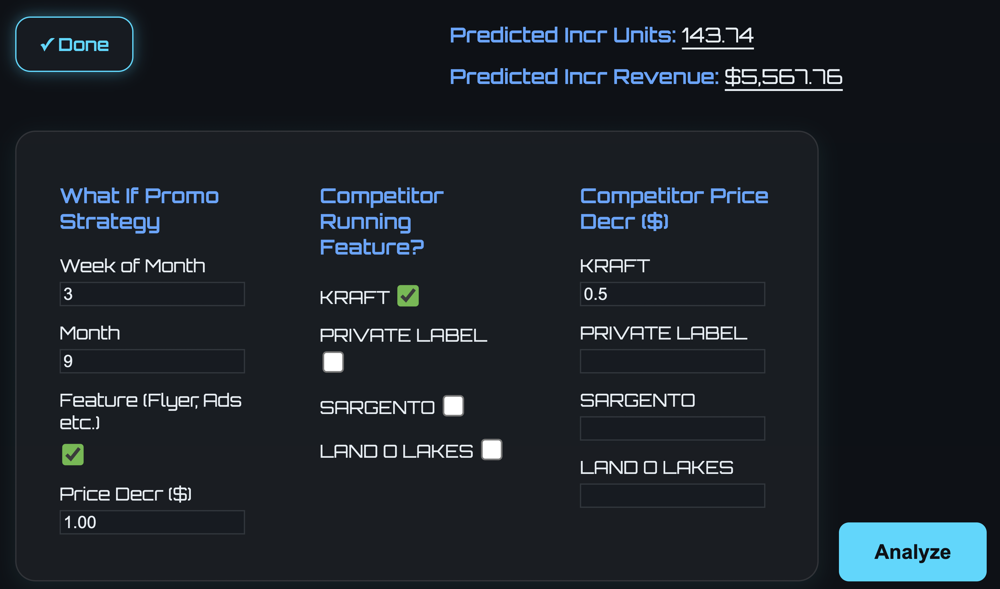

# Trade Promotion Analytics

A team-built prototype from the Wisconsin Tech Exploration Lab, developed around a promotion-planning problem posed by Cub Foods and Crystal Farms. We explored how promotion timing, price changes, and competitor activity could affect sales and revenue. The project won the lab's industry showcase and a $1,000 scholarship.

## What we built

- A FastAPI endpoint and web interface for comparing what-if promotion scenarios.
- Python analysis code that uses Gemini through Vertex AI to estimate changes in units sold and revenue.
- A showcase interface for presenting the scenarios to business users.

## Repository map

- `randomized/backend.py`: API and scenario inputs.
- `randomized/analytics.py`: prediction path and fallback behavior.
- `randomized/frontend/`: web interface.
- `images/screenshot.png`: application screenshot with partner data hidden.

## Status and limitations

This is a showcase snapshot, not a production forecasting service. Private partner data and the generated `db.json` file are not included, so the repository does not run end to end as published. The current fallback in `analytics.py` produces synthetic values if prediction fails; those values are for demo continuity, not validated forecasts.

## Team

Albert Wu, Alec Bhamani, Eric Cao, Adhviklal Thoppe, and Isaac Anderson. Thanks to the Wisconsin Tech Exploration Lab, Cub Foods, and Crystal Farms for the project.

